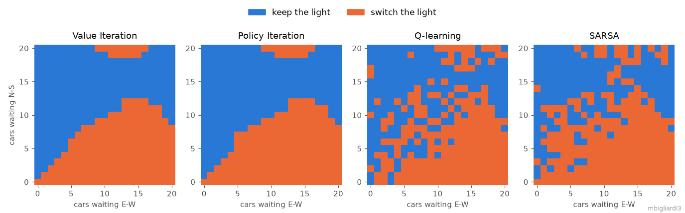
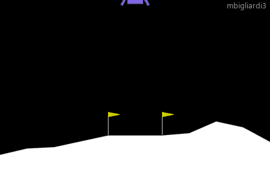
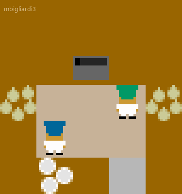
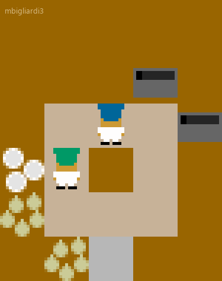
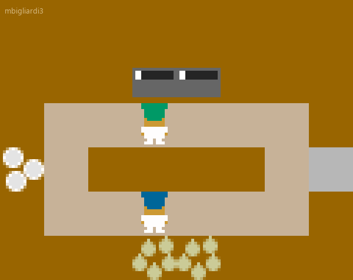
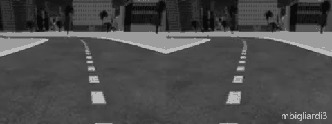
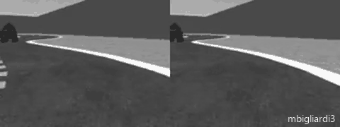

# CS 7642 — Reinforcement Learning

**Georgia Institute of Technology · Online Master of Science in Computer Science (OMSCS) · Fall 2025**

**Final grade: A**

This repository is a write-up of what I studied and built in *CS 7642 Reinforcement Learning*
(also known as *RL*). It covers the topics of the course,
how each project relates to them, and recordings and figures from my own local runs.

> **Why there is no source code here:** Georgia Tech's Academic Honor Code and the course policies
> do not allow students to publish their work. The project descriptions ask students not to post
> their code or reports publicly, while explicitly allowing them to share the work *privately*
> with a potential employer. Because of that, this repository contains only **descriptions written by me**
> and **media from my local runs** (watermarked, as the course asks). It contains no solution code,
> starter code, reports, project specifications or lecture material. If you are a recruiter or an
> interviewer and would like to discuss the implementations, I am happy to walk through them in person.

---

## Table of contents

- [About the course](#about-the-course)
- [Topics at a glance](#topics-at-a-glance)
- [How the pieces connect](#how-the-pieces-connect)
- [Quizzes and final exam](#quizzes-and-final-exam)
- [Projects](#projects)
  - [1. Traffic light control — MDPs, planning and tabular RL](#1-traffic-light-control--mdps-planning-and-tabular-rl)
  - [2. Lunar Lander — DDPG for continuous control](#2-lunar-lander--ddpg-for-continuous-control)
  - [3. Overcooked — cooperative multi-agent RL with MAPPO](#3-overcooked--cooperative-multi-agent-rl-with-mappo)
  - [4. AWS DeepRacer — PPO from camera and LiDAR](#4-aws-deepracer--ppo-from-camera-and-lidar)
- [Skills and tools](#skills-and-tools)
- [Takeaways](#takeaways)
- [Public resources](#public-resources)

---

## About the course

CS 7642 is about **how an agent learns to make good decisions from experience**. There is no labelled data:
the agent acts, observes the consequences and a reward signal, and has to work out which behaviour
leads to the most reward over time. The course follows that question from its foundations to current practice:
Markov decision processes and dynamic programming, temporal-difference learning and its convergence
theory, exploration, generalization with function approximation, partial observability, temporal
abstraction, and finally game theory and multi-agent learning.

The core video lectures are by Charles Isbell and Michael Littman, and are complemented by classic and recent papers. The four projects
climb a ladder of difficulty: a small discrete MDP, a continuous-control task, a cooperative
two-agent game and a simulated race car trained from its own sensors.

| | |
|---|---|
| **Institution** | Georgia Institute of Technology, College of Computing |
| **Program** | OMSCS (Online Master of Science in Computer Science) |
| **Semester** | Fall 2025 |
| **Assessment** | 4 projects (code, written report and, for projects 2–4, a recorded presentation), 4 oral quizzes, a closed-book final exam |
| **Textbooks** | Sutton & Barto, *Reinforcement Learning: An Introduction* (2nd ed.) · Albrecht, Christianos & Schäfer, *Multi-Agent Reinforcement Learning* |
| **Rule for the projects** | No RL libraries: all reinforcement learning code written from scratch (general libraries such as PyTorch allowed for the neural networks) |
| **Language** | Python |
| **Official page** | [omscs.gatech.edu/cs-7642-reinforcement-learning](https://omscs.gatech.edu/cs-7642-reinforcement-learning) |

---

## Topics at a glance

| # | Module | Key ideas |
|---|--------|-----------|
| 1 | **MDPs and Bellman equations** | States, actions, transitions, rewards, discounting, policies, the Bellman equation, value iteration, policy iteration |
| 2 | **Reinforcement learning basics** | Learning from interaction without a model, model-based vs. value-based vs. policy-search learners, evaluating a policy and a learner |
| 3 | **TD and friends** | Incremental estimates and learning-rate conditions, TD(1), TD(0) and TD(λ), k-step estimators and how λ blends them |
| 4 | **Convergence** | Bellman operators as contraction mappings, max as a non-expansion, convergence of Q-learning, generalized MDPs |
| 5 | **Advanced algorithmic analysis** | Value iteration bounds, solving MDPs with linear programming, why policy iteration converges (monotonicity and domination) |
| 6 | **Messing with rewards** | Which reward transformations preserve the optimal policy, reward shaping, potential-based shaping, Q-learning with potentials |
| 7 | **Exploring exploration** | k-armed bandits, confidence-based exploration, Hoeffding bounds, metrics for learners (find best / few mistakes / do well), Rmax, the simulation lemma and the explore-or-exploit lemma |
| 8 | **Generalization** | Linear value-function approximation, when it fails (Baird's counterexample), averagers and their connection to MDPs |
| 9 | **Partially observable MDPs** | Belief states and state estimation, value iteration over beliefs (piecewise-linear and convex value functions), memoryless policies, Bayesian RL, predictive state representations |
| 10 | **Options** | Temporal abstraction, options as semi-MDPs, goal abstraction and arbitration between competing sub-goals, Monte Carlo tree search |
| 11 | **Game theory** | Zero-sum games, minimax and mixed strategies, Nash equilibria, repeated games (tit-for-tat, grim trigger, Pavlov, folk theorem), stochastic games, correlated equilibria, coco values, mechanism design |
| 12 | **Coordinating, communicating, coaching** | Dec-POMDPs, inverse reinforcement learning, policy shaping from human feedback |
| + | **Deep and multi-agent RL (readings)** | Value-based deep RL (DQN family), policy-gradient and actor-critic methods (REINFORCE, DDPG, PPO), cooperative MARL: centralized training with decentralized execution, parameter sharing, MAPPO |

---

## How the pieces connect

Each project is built on one or more lecture modules. Together they walk from tabular planning to deep
multi-agent and robotic control.

| Project | MDPs & planning | TD learning & control | Function approximation | Policy gradient / actor-critic | Exploration | Reward shaping | Multi-agent |
|---|:-:|:-:|:-:|:-:|:-:|:-:|:-:|
| [Traffic light control](#1-traffic-light-control--mdps-planning-and-tabular-rl) | ● | ● | | | ○ | ○ | |
| [Lunar Lander](#2-lunar-lander--ddpg-for-continuous-control) | | ○ | ● | ● | ○ | | |
| [Overcooked](#3-overcooked--cooperative-multi-agent-rl-with-mappo) | | | ○ | ● | ○ | ● | ● |
| [AWS DeepRacer](#4-aws-deepracer--ppo-from-camera-and-lidar) | | | ● | ● | | ● | |

● = main topic of the project · ○ = also used

```text
  known model             one learner,               two learners,             one learner,
  small & discrete        continuous actions         shared reward             raw sensors, many tracks
 ┌──────────────────┐   ┌──────────────────────┐   ┌─────────────────────┐   ┌─────────────────────────┐
 │ VI / PI on a     │ → │ DDPG: deterministic  │ → │ MAPPO: shared actor │ → │ PPO with CNN encoders,  │
 │ traffic MDP,     │   │ actor + Q-critic,    │   │ + centralized critic│   │ reward design and       │
 │ Q-learning/SARSA │   │ replay, target nets  │   │ + annealed shaping  │   │ track-to-track transfer │
 └──────────────────┘   └──────────────────────┘   └─────────────────────┘   └─────────────────────────┘
      Project 1                 Project 2                  Project 3                  Project 4
```

---

## Projects

The four projects were the core of the course. Each one required an implementation written from scratch,
a set of experiments, and a report in the style of a short research paper. From Project 2 on,
it also required a recorded presentation. Grading focused on the **analysis**: why the algorithm behaves the way it does,
what the hyperparameters change, and what the experiments show. A working agent was only the starting point.

The figures and GIFs below come from **my own local runs** (training logs, saved policies and
checkpoints of my agents). None of them is taken from my reports.

### 1. Traffic light control — MDPs, planning and tabular RL

> **Topics:** MDP formulation · value iteration · policy iteration · Q-learning · SARSA · reward design

**Scenario.** A single intersection with a traffic light. Cars arrive from the north-south and east-west
directions at random (Poisson arrivals, with different rates per direction), and while the light is green
a fixed number of cars can leave in that direction. At each step the controller decides whether to **keep**
or **switch** the light. The goal is to keep the queues short and, above all, to avoid letting a queue overflow.

**What I implemented.**
- The environment as a **Gymnasium** MDP. The state is (queue N-S, queue E-W, light), and the full
  transition model is built by enumerating the possible arrivals in each direction, weighting them with the
  Poisson probabilities.
- Two **planners** that use the model: **value iteration** and **policy iteration**.
- Two **model-free learners** that only interact with the simulator: **Q-learning** (off-policy)
  and **SARSA** (on-policy), with ε-greedy exploration that decays over the episodes.
- An experiment driver that sweeps **reward schemes** (overflow penalty only, a dense per-car queue
  penalty, a bonus for clearing the intersection), episodic vs. continuing formulations, symmetric,
  asymmetric and heavy traffic, and the main hyperparameters (γ, convergence threshold, learning rate,
  ε decay, number of episodes). It measures queue lengths, overflows, congestion-free streaks and
  average waiting time.

**What I learned.** How a modelling choice (the reward, the discount, whether the task ends) changes the optimal
policy. How planning with a known model compares with learning from samples. And why on-policy and
off-policy TD control behave differently when exploration is still on.

<p align="center">
  <br>
  <sub>The policy each method ends up with when the north-south light is green, for every combination of queue lengths.
  Value and policy iteration find almost the same clean switching boundary: switch once the east-west queue grows relative to the north-south one.
  Q-learning and SARSA learn the same shape from experience alone. They are noisier in states the traffic rarely visits,
  which is exactly where a model-free learner gets little data.</sub>
</p>

---

### 2. Lunar Lander — DDPG for continuous control

> **Topics:** Deep RL · actor-critic · deterministic policy gradient · experience replay · target networks

**Scenario.** Gymnasium's `LunarLanderContinuous-v3`: land a small spacecraft between two flags. The
agent observes the lander's position, velocity, angle and leg contacts, and controls the **main and lateral
engines with continuous throttle values**. Reward is given for approaching the pad and landing softly. Crashing
and firing the engines both cost reward.

**What I implemented.** **DDPG** from scratch in PyTorch:
- a deterministic actor (tanh-bounded outputs) and a Q-value critic,
- a replay buffer, and target copies of both networks updated with **Polyak averaging**,
- exploration with Gaussian action noise, after an initial phase of uniformly random actions to fill the buffer,
- decaying schedules for the learning rates and the exploration noise,
- logging of returns, losses and schedules, and a 100-episode deterministic evaluation.

I then ran **ablations** on the exploration noise, the Polyak coefficient, the length of the
random warm-up and the actor's learning rate, to see which ones matter for stability.

**What I learned.** Why actor-critic methods need so many stabilizers (replay, target networks, slow
target updates). How sensitive off-policy deep RL is to exploration and step sizes. And how to read the
learning curves when the critic and the actor influence each other.

<p align="center">
  <br>
  <sub>Three landings of my trained agent, run without exploration noise. The lander fires the main engine to brake,
  corrects its drift with the side engines and settles between the flags.</sub>
</p>

---

### 3. Overcooked — cooperative multi-agent RL with MAPPO

> **Topics:** Multi-agent RL · centralized training, decentralized execution · PPO · reward shaping · coordination

**Scenario.** The [Overcooked-AI](https://github.com/HumanCompatibleAI/overcooked_ai) environment, based on
the video game: **two chefs share a kitchen** and must cook and serve onion soups (three onions in a pot,
wait for the soup to cook, plate it, deliver it). The team only earns reward for delivered soups, so the
reward is sparse and shared. The two agents have to learn to **cooperate** in three kitchen layouts:
*Cramped Room* (a tiny shared space), *Coordination Ring* (a ring where the chefs block each other) and
*Counter Circuit* (a long loop where passing items across the counter pays off).

**What I implemented.** **MAPPO**, i.e. multi-agent PPO, from scratch:
- a **shared actor**: both chefs use the same policy network, each on its own observation
  (parameter sharing), so at execution time the agents act independently;
- a **centralized critic** that sees both chefs' observations during training. It encodes each one with
  the same encoder and combines them, so the value does not depend on which chef is which;
- PPO with a clipped objective, GAE advantages, early stopping on the KL divergence, an entropy bonus that
  decreases during training, gradient clipping and running normalization of the observations;
- **reward shaping**: the environment's intermediate rewards (onion in the pot, picking up a dish or
  a soup) help discover the task, then fade out exponentially so the agents end up optimizing the real goal.
  A small training-only signal also encourages the two chefs to work at different pots instead of crowding the same one.

**What I learned.** Why sparse team rewards make multi-agent credit assignment hard. How centralized
training with decentralized execution makes the non-stationarity between learners manageable. And how to use
shaping carefully: helpful early on, harmful if it stays and the agents start optimizing the shaping itself.

<p align="center">
  
  &nbsp;
  
  &nbsp;
  <br>
  <sub>The two chefs at the end of training in <b>Cramped Room</b>, <b>Coordination Ring</b> and <b>Counter Circuit</b>
  (the first half of an episode). The chefs bring onions to the pot, plate the cooked soup and deliver it,
  working around each other in the shared space.</sub>
</p>

---

### 4. AWS DeepRacer — PPO from camera and LiDAR

> **Topics:** Deep RL from high-dimensional observations · PPO · reward design · transfer and fine-tuning · generalization

**Scenario.** A simulated **AWS DeepRacer** car (1/18-scale autonomous racing), running in a
containerized Gazebo/ROS simulator. The car sees the track through a **stereo camera pair and a LiDAR**
and chooses among discrete steering actions. There are three race types, each evaluated on three
different tracks:

- **Time-Trial**: complete laps as reliably as possible on an empty track;
- **Obstacle-Avoidance**: avoid static boxes placed at random on the track;
- **Head-to-Bot**: share the track with bot cars that move and change lane, and get past them without colliding.

**What I implemented.**
- **PPO** from scratch: rollouts, GAE, clipped surrogate objective, value loss, minibatch epochs,
  advantage normalization and gradient clipping, with logging of progress and success rate.
- The **agent**: the starter code's convolutional encoders for the cameras and the LiDAR, with my own
  input normalization, feeding separate policy and value heads.
- A single **reward function** that detects the race type from the environment settings.
  For Time-Trial it rewards staying near the centre line, pointing along the track, steering smoothly
  and making progress. For Obstacle-Avoidance and Head-to-Bot it treats the road as **two lanes**:
  when the nearest obstacle or bot gets close, the reward shifts toward the opposite lane, and it relaxes
  the smoothness penalties so the car can swerve.
- **Transfer across tracks**: train on one track, then fine-tune the same network on the next
  with a lower learning rate, and evaluate every agent on all three tracks. The experiments were driven by scripts
  that reconfigure and restart the simulator for each stage.

**What I learned.** Reward design is most of the work in a robotics-style task, and small changes to the reward
visibly change how the car drives. Learning from pixels is much less sample-efficient than learning from a compact state.
Fine-tuning helps an agent carry skills from one track to the next, but generalizing to a track it has never seen
is a separate and harder problem.

<p align="center">
  <br>
  <sub><b>Time-Trial.</b> What the agent sees: the stereo camera pair while my final Time-Trial agent drives the
  <i>AWS Summit Raceway</i> track (sped up 2×).</sub>
</p>

<p align="center">
  <br>
  <sub><b>Head-to-Bot.</b> The car moves to the free lane and gets past a bot car (the dark vehicle entering from the right)
  on the <i>Smile Speedway</i> track.</sub>
</p>

---

## Skills and tools

- **Planning and tabular RL**: MDP modelling, value iteration, policy iteration, Q-learning, SARSA
- **Deep RL**: DDPG and PPO implemented from scratch, replay buffers, target networks, GAE,
  clipped objectives, entropy regularization, learning-rate and exploration schedules
- **Multi-agent RL**: MAPPO, centralized critics, parameter sharing, cooperative reward shaping
- **Reward design**: potential-style shaping, annealed shaping, task-specific reward functions for driving
- **Experimentation**: ablation studies, seeded runs, experiment scripts, evaluation protocols separate from
  training, and plots built from logged CSVs
- **Stack**: Python, PyTorch, NumPy, pandas, Matplotlib, Gymnasium, Overcooked-AI, the DeepRacer simulator
  (Docker / Apptainer), conda, Linux and WSL

---

## Public resources

These are freely available materials I found useful alongside the course:

- [OMSCS course page for CS 7642](https://omscs.gatech.edu/cs-7642-reinforcement-learning)
- R. Sutton, A. Barto: [*Reinforcement Learning: An Introduction*, 2nd ed.](http://incompleteideas.net/book/the-book-2nd.html), MIT Press, 2018
- S. Albrecht, F. Christianos, L. Schäfer: [*Multi-Agent Reinforcement Learning: Foundations and Modern Approaches*](https://www.marl-book.com/), MIT Press, 2024
- [OpenAI Spinning Up](https://spinningup.openai.com/) (clear explanations of DDPG and PPO)
- T. Lillicrap et al., [*Continuous control with deep reinforcement learning*](https://arxiv.org/abs/1509.02971) (DDPG), 2015
- J. Schulman et al., [*Proximal Policy Optimization Algorithms*](https://arxiv.org/abs/1707.06347), 2017
- C. Yu et al., [*The Surprising Effectiveness of PPO in Cooperative Multi-Agent Games*](https://arxiv.org/abs/2103.01955) (MAPPO), 2022
- A. Ng, D. Harada, S. Russell, *Policy invariance under reward transformations: theory and application to reward shaping*, ICML 1999
- [Gymnasium](https://gymnasium.farama.org/), [Overcooked-AI](https://github.com/HumanCompatibleAI/overcooked_ai) and [AWS DeepRacer](https://docs.aws.amazon.com/deepracer/) documentation

---

<sub>All descriptions are my own. Project scenarios are summarized only at the level needed to give
context. Figures and recordings come from my local runs and are watermarked with my GT username. No course code,
specifications, reports or lecture content are included.</sub>
